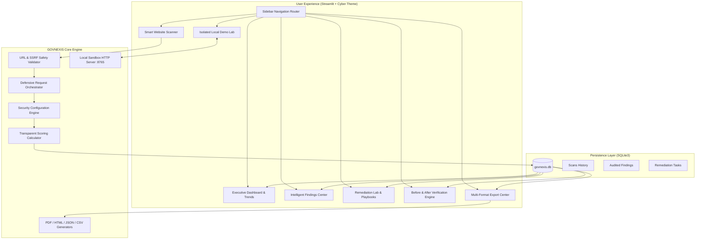

# GOVNEXIS

> **Intelligent Government Web Security Auditing Platform**  
> *"See the Risk. Fix the Gap. Build Trust."*

---

## 🏛️ Executive Summary

**GOVNEXIS** is an intelligent, defensive cybersecurity auditing platform designed specifically for authorized public sector agencies, municipal portals, and government website administrators. It enables authorized teams to:

1. **Identify Security Configuration Weaknesses**: Non-destructively audit HTTP response headers, cookie attributes, TLS cryptographic parameters, and redirect behaviors.
2. **Understand Operational Impact**: Translate technical header omissions into clear, CVSS/CISA-aligned threat models and citizen trust risks.
3. **Prioritize Remediation**: Deliver battle-tested server configuration playbooks for Nginx, Apache, Caddy, Node.js, and Python.
4. **Empirically Verify Improvements**: Validate remediation through repeatable before-and-after follow-up audits with quantified delta metrics.

GOVNEXIS adheres strictly to **CISA Binding Operational Directive (BOD) 18-01**, **NIST SP 800-52 Rev. 2**, and **OWASP Secure Headers Project** guidelines.

---

## 🏗️ System Architecture



---

## 🛡️ Core Features

| Feature | Description |
| :--- | :--- |
| **Executive Security Dashboard** | Real-time aggregate KPIs, severity donut charts, category distribution, and longitudinal score trajectories powered by Plotly. |
| **Smart Website Scanner** | Defensive, SSRF-guarded auditing engine enforcing owner authorization, strict timeouts, hop limits, and TLS observations. |
| **10 Configuration Checks** | Evaluates HTTPS enforcement, HSTS, CSP, X-Frame-Options, X-Content-Type-Options, cookie security flags, Referrer-Policy, Permissions-Policy, server banners, and TLS certificates. |
| **Intelligent Findings Center** | Searchable and filterable vulnerability management center with transparent rule-based prioritization (no opaque AI claims). |
| **Remediation Lab** | Ready-to-deploy configuration snippets for Nginx, Apache, Caddy, Node.js (Helmet), and FastAPI/Django, plus compatibility warnings. |
| **Before-and-After Verification** | Quantified verification engine calculating score delta (+pts), resolved check lists, and side-by-side header diffs. |
| **Isolated Local Demo Lab** | Safe localhost sandbox on `127.0.0.1:8765` simulating misconfigured baseline vs. hardened states for live hackathon demos. |
| **Professional Report Generator** | Export compliant audit reports in 4 formats: Vector PDF (ReportLab), Cyber HTML with print CSS, JSON, and CSV. |
| **Transparent Security Score** | Fully explainable 0–100 score reflecting weighted check evaluations and independent visibility of critical risks. |

---

## 🔒 Defensive Safeguards & Legal Compliance

GOVNEXIS is an **auditing and hardening platform**, not an offensive exploitation framework:
- **SSRF Defense**: Automatically blocks scans against private RFC 1918 subnets (`10.0.0.0/8`, `172.16.0.0/12`, `192.168.0.0/16`), loopback (`127.0.0.0/8`), link-local (`169.254.0.0/16`), and multicast addresses.
- **DNS Rebinding Protection**: Resolves target hostnames and validates destination IP addresses prior to connecting.
- **Safe Redirect Tracing**: Validates each redirect hop (max 5 hops) to ensure targets cannot pivot to prohibited destinations.
- **Strict Timeouts**: 5-second connect timeout and 8-second read timeout prevent hung connections.
- **No Intrusive Testing**: Does not inject exploit payloads, perform SQL injection, attempt directory traversal, or execute brute-force attacks.
- **Mandatory Ownership Affirmation**: Explicit authorization affirmation is required before any scan is executed.

---

## 💻 Technology Stack

- **Backend / Engine**: Python 3.10+ (Standard library `socket`, `ssl`, `ipaddress`, `sqlite3`)
- **Web UI & Dashboard**: Streamlit, Plotly Express & Graph Objects, Pandas
- **Reporting**: ReportLab (PDF), Jinja2 / HTML5, CSV, JSON
- **Network Client**: Requests (with custom session adapters and streaming response limits)
- **Test Framework**: Pytest

---

## 🚀 Installation & Launch (Linux)

### 1. Prerequisites
Ensure Python 3.10+ is installed on your Linux system.

### 2. Virtual Environment Setup
```bash
# Clone or navigate to the repository directory
cd GOVNEXIS

# Create a virtual environment
python3 -m venv .venv

# Activate the virtual environment
source .venv/bin/activate

# Install required dependencies
pip install -r requirements.txt
```

### 3. Launch GOVNEXIS
```bash
# Run the Streamlit web application
python -m streamlit run app.py
```
By default, the platform will be available at:
👉 **`http://localhost:8501`**

---

## 🧪 Running Automated Tests

GOVNEXIS includes a comprehensive automated test suite covering network safety, SSRF blocking, rule evaluations, scoring mathematics, database persistence, report generation, and the local demo lifecycle.

```bash
# Activate virtual environment
source .venv/bin/activate

# Execute all automated tests
pytest -v tests
```

---

## 🎮 Step-by-Step Hackathon Demo Script (3 Minutes)

Follow this script to deliver a compelling live demonstration:

1. **Open the Executive Dashboard (0:00 - 0:30)**:
   - Navigate to `http://localhost:8501`.
   - Show the **Executive Security Dashboard** with KPI cards (Scans, Targets, Average Score, Resolved Issues) and Plotly charts.
   - Click *"🚀 Load Hackathon Sample Scans (Demo)"* to instantly demonstrate rich historical trend analytics.

2. **Run the Local Sandbox Baseline Scan (0:30 - 1:15)**:
   - Navigate to **"8. Local Demo Lab"** in the sidebar.
   - Point out the **Sandbox Server Status (ONLINE at 127.0.0.1:8765)** and the clear isolated demo banner.
   - Click **"1️⃣ Run Baseline Demo Scan"**.
   - Observe the baseline score (e.g., 20–35/100, Grade F) with highlighted critical findings: missing CSP, missing HSTS, missing X-Frame-Options, and insecure cookies.

3. **Apply Hardening Fixes & Rescan (1:15 - 2:00)**:
   - Click **"2️⃣ Apply Demo Fixes (Harden)"** to simulate applying production web server configuration.
   - Click **"3️⃣ Rescan Hardened Demo"**.
   - Watch the score immediately update to **95/100 (Grade A+)**, demonstrating a **+75 pt verification delta**!

4. **Showcase the Remediation Lab & Reports (2:00 - 3:00)**:
   - Navigate to **"4. Remediation Lab"** to show production-ready Nginx, Apache, and Caddy snippets with compatibility notes.
   - Navigate to **"5. Before & After Verification"** to show the side-by-side header diff viewer.
   - Navigate to **"7. Reports"** and click **"📄 Download PDF Report"** or preview the interactive HTML report to demonstrate shareable deliverables for executive leadership.

---

## 🗺️ Project Roadmap

- [x] Non-destructive HTTP header and cookie audit engine
- [x] SSRF-safe network validator and DNS rebinding protections
- [x] Transparent, explainable CISA/NIST-aligned scoring model
- [x] Remediation Lab with multi-server configuration snippets
- [x] Before-and-after empirical verification engine
- [x] Isolated local demo sandbox on port 8765
- [x] Multi-format report export (PDF, HTML, JSON, CSV)
- [ ] Automated scheduled scans via cron integration
- [ ] Webhook alerts to agency SIEM / Slack / Microsoft Teams
- [ ] Subdomain inventory enumeration via public Certificate Transparency (CT) logs

---

## 👥 Contributors & Acknowledgements

- **GOVNEXIS Security Engineering Team**
- Built for government agency transparency and citizen digital trust.
- Standards reference: CISA BOD 18-01, NIST SP 800-52 Rev. 2, OWASP Secure Headers.
